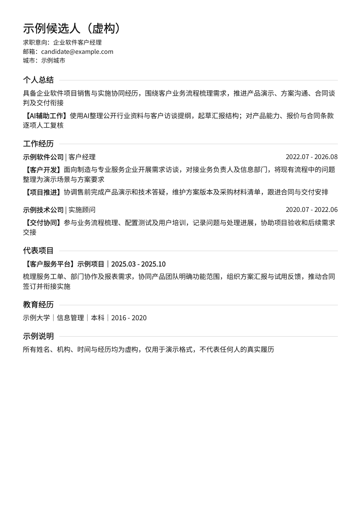
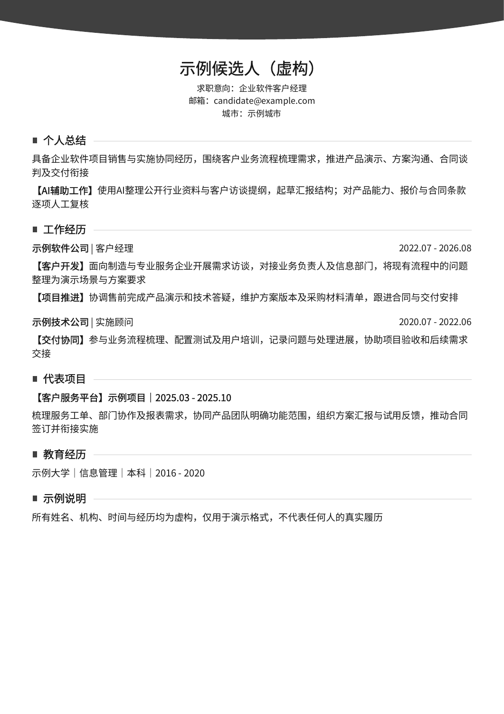

# 简历改写与排版 · Resume Rewrite

把原简历改成贴合目标岗位、事实清楚、能继续编辑的版本。支持岗位调研、按 JD 改写、局部调整，以及中文单页 A4 PDF。

它把**岗位要求、候选人自述和待确认内容**分开处理。不会用招聘关键词替候选人补能力，也不会为了填满页面编造教育、项目或业绩。

## 效果示例

以下全部使用虚构资料，无真人照片或履历。

| 简洁单列 `plain` | 灰色弧顶 `classic` |
|---|---|
|  |  |

[查看示例源稿](examples/fictional-resume.md) · [简洁版 PDF](docs/plain-demo.pdf) · [弧顶版 PDF](docs/classic-demo.pdf)

## 能做什么

- 研究目标岗位，把要求对应到候选人已经做过的项目
- 写清本人动作、项目阶段和结果口径，减少空泛评价
- 只改指定段落，保留最新日期、已删栏目和用户选择
- 把 AI 技能写到客户调研、方案初稿等具体应用，并区分做过与待确认
- 生成可提取文字的 PDF，检查缺字、溢出和源稿一致性

仅改措辞时不强制联网；只使用文字改写时不需要安装 Python 依赖。调研使用当前 Agent 已有的工具，不要求私人 API 或特定付费服务。

## 安装

适用于能读取 `SKILL.md` 的 Agent。以 Codex 用户级目录为例，在终端执行：

```bash
git clone https://github.com/yuansuke-cloud/resume-rewrite-skill.git
mkdir -p "${CODEX_HOME:-$HOME/.codex}/skills"
cp -R resume-rewrite-skill/skills/resume-rewrite   "${CODEX_HOME:-$HOME/.codex}/skills/"
```

如果目标目录已有同名 Skill，先比较并备份自己的版本。也可下载 [Releases](https://github.com/yuansuke-cloud/resume-rewrite-skill/releases) 中的 ZIP，把其中的 `resume-rewrite` 文件夹放入 Agent 的技能目录。

## 使用

提供原简历和目标岗位即可；有已确认的当前稿或参考版式时一并说明。

```text
使用 $resume-rewrite，先研究这个岗位，再根据我的原简历优化内容。
不要补造业绩，缺失的关键事实单独列出。
```

```text
使用 $resume-rewrite，只修改个人总结里的 AI 应用描述。
以我提供的实际使用经历为准，其他段落与日期保持不变。
```

```text
使用 $resume-rewrite，把这份已确认的文字稿排成一页 PDF。
使用 classic 样式，不添加照片，不改正文。
```

Skill 入口：[SKILL.md](skills/resume-rewrite/SKILL.md)。用户要求文件时会继续制作；只要文字时不会额外生成一套报告。

## 单独运行 PDF 脚本

需要 Python 3.10+，以及覆盖全部正文字符的静态 TrueType 字体（TTF 或兼容 TTC）。脚本没有网络调用，不下载字体，不需要 API Key。

```bash
cd resume-rewrite-skill
python3 -m venv .venv
# Windows 创建虚拟环境可用 py -3 -m venv .venv
# macOS / Linux
source .venv/bin/activate
# Windows PowerShell: .venv\Scripts\Activate.ps1
python -m pip install -r skills/resume-rewrite/requirements.txt

python skills/resume-rewrite/scripts/render_resume_pdf.py   --markdown examples/fictional-resume.md   --output output/resume.pdf   --style plain   --font /path/to/chinese-font.ttf
```

使用 `--style classic` 切换灰色弧顶；只有需要本人照片时才提供 `--photo /path/to/photo.jpg`。照片不随本仓库提供。输入格式、字体与完整选项见[脚本说明](skills/resume-rewrite/references/renderer-contract.md)。

脚本专注单页 A4，正文不低于10pt，放不下会停止且不覆盖旧 PDF。长履历可以精简或改用多页排版工具。单列与可提取文字不等于通过所有招聘系统的解析或评分。

### 中文字体

使用自己有权使用的静态字体。演示采用 [Noto Sans SC](https://github.com/google/fonts/tree/main/ofl/notosanssc)，字体遵循 SIL OFL 1.1；本仓库不分发原始字体文件。示例构建方法和完整许可见[素材说明](docs/ASSETS.md)。系统字体是否可以再分发，不能仅凭本机可用作判断。

## 验证与开发

```bash
python -m pip install -r requirements-dev.txt
python scripts/validate_skill.py
python -m unittest discover -s tests -v
python scripts/package_skill.py
```

自动检查覆盖结构、输入解析、文本一致性、溢出保护与文件安全；[行为评测用例](evals/cases.md)用于检查 Agent 在事实缺失、局部修改和文档注入等情境下的实际表现。PDF还需要整页视觉检查，程序不会把它自动标为通过。

如需 GitHub Actions 自动验证，可把[工作流示例](docs/validate-workflow.yml)放到自己仓库的 `.github/workflows/validate.yml`；它配置了 Windows、macOS 和 Linux 三个平台。本仓库首次发布未启用远端自动运行，已完成本地测试。

欢迎提交不含私人资料的复现样例。不要把真实简历、照片、联系方式或账号配置放入 issue、测试或公开产物。

## 许可

源代码与文档采用 [MIT](LICENSE)。示例 PDF 内嵌的 Noto 字体子集继续遵循[原字体许可](docs/licenses/NotoSansSC-OFL.txt)。灰色弧顶和分区符号由脚本绘制，未复用外部纹理或图标字体。
